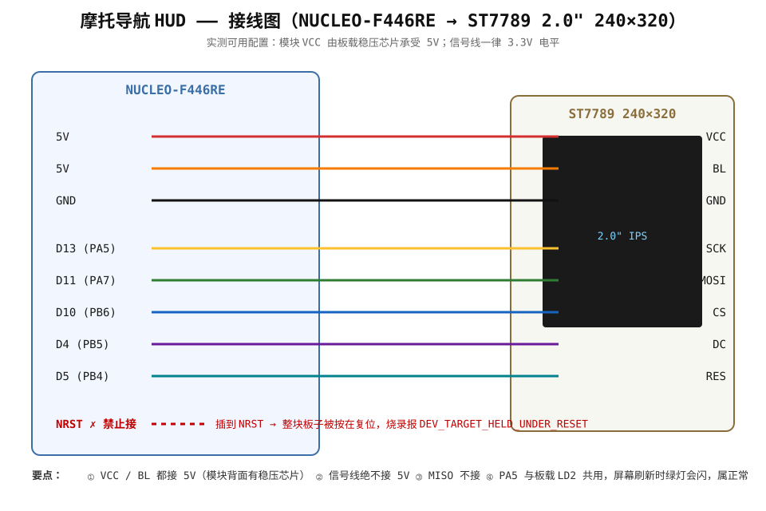

# 摩托导航 HUD（Moto Nav HUD）

基于 STM32F446 + BLE 的骑行导航辅助显示终端原型。手机负责路线与定位，STM32 负责车载显示：转向、距离、车速、断连告警。

> 定位：**个人桌面原型**。不做整车上路、不做防水与 12V 供电。

**当前状态**（诚实版，随里程碑更新）

| 模块 | 状态 |
|---|---|
| 协议定义 v1 | ✅ 完成，8 条样例帧 CRC 实测全对 |
| 协议解析核心 | ✅ 完成，PC 侧 **96 项单元测试全绿** |
| PC 上位机模拟器 | ✅ 完成（发送 / 故障注入 / 回显日志） |
| 硬件 | ✅ 到货，板级验收通过 |
| 屏驱动（ST7789） | ✅ 点亮：三纯色 + 寻址验证通过，全屏刷新实测 **111.02 ms** |
| 串口链路（M3） | ✅ 端到端打通：5Hz 灌帧零丢帧，错 CRC/半帧/粘包注入全部正确恢复 |
| LVGL 界面（M4） | ✅ 完成：转向符号 + 距离 + 车速/里程/ETA + 状态条，318KB Flash / 55KB RAM |
| RTOS | ✅ 三任务静态分配、条件喂狗、3000 帧动态长测通过，见 M5 文档 |
| 蓝牙 | ✅ PC BLE 三轮短测 402 帧确认，安卓收发、偏航及重连恢复通过；距离/长测待测 |

---

## 1. 数据流

```
 PC 上位机（M3）           手机 App（V2，不做）
        │  16 字节定长帧 @5Hz          │
        └──────────┬──────────────────┘
                   ▼
          UART（M3: 板载 VCP / M7: DX-BT24）
                   │  循环 DMA + IDLE/HT/TC → 环形缓冲
                   ▼
        ┌──────────────────────┐
        │ proto_feed()         │  纯 C，不依赖 HAL/RTOS，PC 可测
        │ 帧头搜索 / 定长接收  │
        │ CRC / 重同步         │
        └──────────┬───────────┘
                   │ 最新值邮箱
                   ▼
        ┌──────────────────────┐
        │ ST7789 240×320 显示  │
        └──────────────────────┘
```

---

## 2. 快速开始（不需要硬件）

当前开发基线、命令行固件构建及串口配置见 [开发基线](docs/11-development-baseline.md)。
当前 CubeIDE 导入、四种构建配置及调试方法见 [工程入口](docs/17-cubeide.md)。FreeRTOS 任务设计见 [M5 多任务固件](docs/12-freertos.md)。
当前 UART 接收已升级为 [循环 DMA + 空闲中断](docs/13-uart-dma.md)，边界与故障恢复回归通过。
DX-BT24 接线、独立 BLE 固件及已通过的 PC 无线短测见 [BLE 接入](docs/14-ble-bringup.md)。
安卓手机已通过首帧解析与 ACK 回传，更多场景与 HEX 测试帧见 [手机验收](docs/15-android-test.md)。
本块面板的反色问题已修正，用户确认黑底白字及红绿状态条正常，见 [颜色修复](docs/16-display-colors.md)。
当前 USART2 固件为 **115200 8N1**，以下硬件命令已显式指定波特率。

```powershell
# 协议解析核心的单元测试（宿主机 gcc）
.\tests\run.ps1
# 期望最后一行：ALL PASS (96 checks)

# 上位机自检（CRC / 回环 / 故障场景），不需要 pyserial
python tools\sim_sender.py --selftest

# 打印样例帧，可贴进串口助手的 HEX 发送框
python tools\sim_sender.py --demo
```

有硬件之后：

```powershell
pip install pyserial
python tools\sim_sender.py --port COM13 --baud 115200 --log                # 5Hz 灌帧 + 看板子回显
python tools\sim_sender.py --port COM13 --baud 115200 --fault badcrc       # 故障注入：错 CRC
python tools\sim_sender.py --port COM13 --baud 115200 --fault glue         # 粘包
python tools\sim_sender.py --port COM13 --baud 115200 --fault all --seconds 60
```

---

## 3. 目录

```
moto-nav-hud/
├── docs/
│   ├── 00-source-summary.md   原始规划稿的摘要与取舍
│   ├── 01-plan.md             施工图：M0–M8 里程碑、出口判据、退路
│   ├── 02-protocol.md         协议 v1 实现契约
│   ├── 03-hardware.md         接线表、供电预算、仪器与测量点
│   ├── 04-bringup.md          分阶段上电验收
│   ├── 05-decisions.md        设计决策记录（每条含反方案与代价）
│   ├── 06-metrics.md          量化指标登记处（简历数字的唯一来源）
│   ├── 07-cubemx-setup.md     CubeIDE 2.x 环境搭建（无 CubeMX 图形界面）
│   ├── 08-project-overview.md 项目要点与技术点总览
│   ├── 09-resume.md           简历条目 / 技能关键词 / 面试追问
│   └── log.md                 调试日志（真实踩坑记录）
├── firmware/
│   ├── Inc/                   协议、驱动、HAL 与 FreeRTOS 配置头文件
│   ├── Src/                   三任务应用、协议解析、ST7789 与 LVGL 移植层
│   ├── Startup/               Cortex-M4 启动与向量表
│   └── lv_conf.h              LVGL 功能及内存配置
├── tests/                     宿主机单元测试（96 项）
└── tools/sim_sender.py        PC 端模拟器 / 故障注入器
```

---

## 4. 硬件

| 部件 | 型号 | 关键参数 |
|---|---|---|
| 主控 | NUCLEO-F446RE | Cortex-M4F 180MHz，512KB Flash / 128KB RAM，板载 ST-Link + VCP |
| 显示屏 | ST7789 2.0" 240×320 IPS | SPI，**模块 VCC 需 5V**（背面带稳压芯片） |
| 蓝牙 | 大夏龙雀 DX-BT24 | BLE 5.1（DA14531），UART 透传，出厂 9600 8N1 |
| 输入 | 轻触按键 ×3 | 内部上拉，按下接地 |
| 提示 | 有源蜂鸣器 + S8050 | IO 经三极管驱动 |

接线与供电见 [`docs/03-hardware.md`](docs/03-hardware.md)。



演示视频的拍法见 [`docs/10-demo-script.md`](docs/10-demo-script.md)（45 秒分镜脚本）。

---

## 5. 软件栈

- STM32CubeIDE 2.2.0（**该版本已移除 CubeMX 图形界面，HAL 需手工集成**）
- arm-none-eabi-gcc 14.3.1 + HAL
- FreeRTOS-Kernel V11.1.0（M5 引入，原生 API + 静态任务/队列）
- LVGL 8.x（M4 引入）
- 自定义二进制协议（见 [`docs/02-protocol.md`](docs/02-protocol.md)）

**一条贯穿全项目的约束**：`firmware/Src/proto_parser.c` 和 `firmware/Inc/proto.h` 不许 include 任何 HAL / FreeRTOS 头文件。协议核心必须能在 PC 上独立编译和测试。

---

## 6. 关键设计决策

摘要（完整版见 [`docs/05-decisions.md`](docs/05-decisions.md)）：

1. **16 字节定长帧**：BLE 默认有效载荷 20 字节；定长让状态机退化成"计数到 16 就校验"，不需要长度分支。
2. **CRC 失败只回退 1 字节**：清空缓冲会把已收进的下一帧开头一起丢掉，表现为"错一帧、连丢一串"。
3. **`seq` 不做重传**：5Hz 状态帧有 200ms 时效性，重传的旧数据比没有更糟；`seq` 只用于统计丢包率。
4. **混用单位**（`dist_m` 用米、`remain_dam` 用 10 米）：精度需求与量程需求冲突，只能拆开。
5. **240×40 单缓冲**：全屏缓冲 150KB > 128KB RAM，当前使用 19.2KB 单缓冲和同步 SPI 刷新；双缓冲与 DMA 留待后续评估。
6. **M3 用板载 VCP 灌帧**：`proto_feed()` 只认字节不认串口，换物理层零改动。

---

## 7. 实测指标（来源见 `docs/06-metrics.md`）

| 指标 | 实测值 | 测量方法 |
|---|---|---|
| 全屏 240×320 填充 | **111.02 ms** | DWT 周期计数器，19,983,835 周期 @180MHz |
| 局部 240×40 填充 | **13.90 ms** | 同上，2,501,154 周期 |
| SPI 时钟 | 11.25 MHz | APB2 90MHz ÷ 8 |
| 当前 DMA 固件占用 | **262.6 KiB Flash / 67.9 KiB RAM**（含 LVGL 与静态任务栈） | GNU ld 区域使用，Arm GCC 14.3.1、`-Os` |
| 协议单元测试 | 96 项全绿 | `tests\run.ps1` |
| M5 中断版动态长测 | **3000/3000**，600.313 秒，约 5Hz | 历史 ELF 的回显及复位计数；DMA 版需独立长测 |
| 当前 DMA 专项 | 861 个有效帧全部确认，缓冲溢出 0，故障重启 8/8 | 含 300 帧动态导航、缓冲边界、连续数据和 UART 故障注入 |
| RTOS 看门狗 | UI 挂起后自动复位，**标称约 4s** 超时 | BKP0R 计数 7→8；未测精确延时 |

> 传输效率 101.6%（实测 / 理论），说明耗时几乎全是 SPI 传输本身，驱动开销 <2%。

---

## 8. 进度

- [x] M0 仓库与工具链
- [x] M1 板级验收
- [x] M2 屏幕点亮（三纯色 + 寻址验证 + 刷新耗时实测）
- [x] M3 协议链路打通（端到端零丢帧，故障注入验收全过）
- [x] M4 LVGL 界面（LVGL 8.3.11，240×40 单缓冲 + flush_cb）
- [x] M5 RTOS 化（三任务、覆盖邮箱、条件喂狗、动态长测）
- [ ] M6 稳定性与量化指标
- [ ] M7 蓝牙全链路（PC BLE 双向短测通过；手机及距离验收待补）
- [ ] M8 交付

验收标准见 [`docs/04-bringup.md`](docs/04-bringup.md)。

---

## 9. 致谢

- 协议分层思路参考 [deanthecoder/SteedPilot](https://github.com/deanthecoder/SteedPilot)（MIT）
- 单片机端界面与地图架构思路参考 [FASTSHIFT/X-TRACK](https://github.com/FASTSHIFT/X-TRACK)（MIT）

本项目代码为独立实现。
