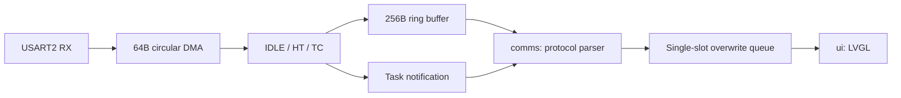

# USART2 循环 DMA 接收

## 实现

USART2 RX 使用 DMA1 Stream5 / Channel4，64 字节循环缓冲，115200 8N1。
保留半满 HT、全满 TC 和 UART 空闲 IDLE 事件。
UART 和 DMA IRQ 均为 FreeRTOS 可调用 FromISR API 的优先级 5，互不抢占。
参考 [ST NUCLEO-F446RE 循环 DMA 示例](https://github.com/STMicroelectronics/STM32CubeF4/tree/master/Projects/STM32446E-Nucleo/Examples/UART/UART_ReceptionToIdle_CircularDMA)。



正常接收只启动一次 `HAL_UARTEx_ReceiveToIdle_DMA`，事件回调不重新启动 DMA。
保留 HT/TC 是为了处理长连续数据：不能只等 IDLE，否则 DMA 缓冲可能已经覆盖。
这更新了早期 `firmware/README.md` 中单次 DMA 接收的教学示例，不能混用重启规则。

回调从 NDTR 读取实时写位置，按上次位置到当前位置的新增区间搬字节。
不直接将 HAL 的 Size 当作新增长度，也不盲目回退游标：
IDLE 和 HT/TC 可能邻近或重复，滞后的边界回调也可能带着旧 Size。
每个回调都采样实时位置，位置相同不重复复制。
M4 没有数据缓存，使用内存屏障后读取 DMA 数据。

中断只搬字节、计数并通知 comms，解析仍在任务中完成。
环形缓冲满时丢新字节并计数；导航 mailbox 仍覆盖旧状态。
64B 缓冲下，115200 8N1 的半缓冲传输时间约 2.78ms，
必须及时处理事件；长时间屏蔽中断导致 DMA 绕过整圈的情况不在无损保证内。

## UART/DMA 错误恢复

HAL 错误回调只记录错误、设置恢复请求并通知通信任务。
comms 在任务上下文恢复接收：

1. 仅关闭 UART/DMA 的 NVIC IRQ，保留 SysTick，避免 HAL 超时失去时基。
2. 终止旧接收并清除 UART 错误，丢弃残留字节和半帧。
3. 重置 DMA 消费位置与环形缓冲，重新开启循环 DMA，恢复两个 IRQ。
4. 启动失败会计数，并在下一轮重试；只有后续有效协议帧才更新连接时间。

恢复过程中不承诺保留故障附近的字节；需要验证后续好帧能正常接收。

## 复现验证

```powershell
.\tools\build-firmware.ps1 -ToolchainBin 'D:\path\to\tools\bin'
.\tests\run.ps1
python tools\sim_sender.py --selftest
python tools\hardware_regression.py --port COM13 --frames 300 --vary-ui --dma-cases --output firmware\build_cli\dma-regression.json
```

DMA 专项包含连续 32/64/80/256/1280/2560 字节、64 个缓冲偏移、
64 字节块在 1/15/16/31/32/33/63 处分片，以及临时半速波特率错误注入。
专项验证 ACK 的数量和顺序；波特率故障还必须结合板上 UART 错误和 DMA 重启计数，
才能证明真正进入了错误恢复分支。

`g_app_metrics` 保留前 11 个字段，末尾增加六个 uint32_t：
IDLE 次数、HT 次数、TC 次数、搬入字节数、故障重启成功次数、启动失败次数。
当前为 17 个字段，共 68B。地址以当前 ELF 的 nm 输出为准。
计数是回调事件数，不能直接等同于 CPU 使用率或完整中断耗时。

原 RTOS 逐字节接收版备份在本机 `firmware/build_baseline/app_rtos_it.elf`。
本次接收链路变更后，需要单独记录结果，不能沿用旧固件的 10 分钟报告。

## 2026-11-18 实测

- Arm GCC 14.3.1、`-Os`，完整编译 220 个源文件、链接及烧录校验通过。
- 正常 ELF SHA-256：`BE03D9D669320494D0C0A22CF7ED33D1D61319F418D3ACB972ED6301860EA09D`。
- Flash 区域使用 268,952 B（51.30%）；RAM 区域使用 69,552 B（53.06%）。
- 协议测试 96 项、模拟器自检通过。
- 300 帧动态导航及全部 DMA 专项通过，ACK 数量与顺序一致。
- 板上有效帧计数 861，与该轮全部预期有效帧数一致。
- DMA 搬入字节 13,911，IDLE/HT/TC 回调计数分别为 395/218/216。
- 故障注入后 UART 错误计数 8、DMA 成功恢复 8、启动失败 0，后续有效帧正常确认。
- 环形缓冲溢出 0，启动计数 10 → 10，未发生计数复位。
- 最终栈最小余量：comms 1824 B、ui 6556 B、mon 1924 B。

原始报告 `firmware/build_cli/dma-regression.json`，诊断前后快照 `dma-before.log`、`dma-after.log`。
本次是一次动态短测加边界/故障回归，不是 10/30 分钟长测；
CPU 使用率、极限吞吐和实际 ISR 最坏延时均未测。
历史 M5 的 10 分钟逐字节中断版报告仅对对应 ELF 有效。
